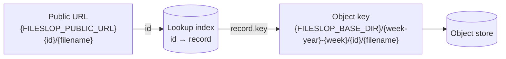

# ADR-004: File identifier and object key layout

Status: Accepted

Date: 2026-10-29

## Context

Each upload needs a unique identifier.
The public URL must be stable and must not be easy to guess.
Operators must find objects in the bucket by date.
The bucket can contain other data. Fileslop objects need a separate prefix.

## Decision

- The identifier is a UUID version 4 from `crypto.randomUUID()`.
- The object key has this format:

```text
<FILESLOP_BASE_DIR>/<ISO-week-year>-<ISO-week>/<id>/<filename>
```

- The ISO week has two digits.
- Example: `fileslop/2026-44/550e8400-e29b-41d4-a716-446655440000/plan.html`.
- Use the ISO 8601 week-year, not the calendar year.
- At a year boundary the two years can be different. Example: 2027-01-01 is in week `2026-53`.
- Calculate the week from the upload time in UTC.
- The public URL has this format: `<FILESLOP_PUBLIC_URL><id>/<filename>`.
- Example: `https://files.example.org/fileslop/550e8400-e29b-41d4-a716-446655440000/plan.html`.

The URL does not contain the week. The server finds the object key in the index:



## Consequences

Positive:

- UUID v4 has 122 random bits. Nobody can guess an identifier.
- The filename in the URL tells a human what the file is.
- The week folder lets operators find and delete old objects with bucket lifecycle rules or scripts.
- The `<id>/` folder prevents name collisions between uploads with the same filename.

Negative:

- The URL does not contain the week. The server cannot calculate the object key from the URL. The server needs a lookup index (see [ADR-005](ADR-005.md)).
- ISO week-years are not obvious to all operators. This document and a unit test define the behavior.

## Alternatives considered

- Calendar year and month: the requirement asks for week folders. Rejected.
- UUID v7: the key can come from the embedded timestamp. See [ADR-005](ADR-005.md).
- Short random identifiers: shorter URLs, but less entropy and a collision risk. Rejected.
