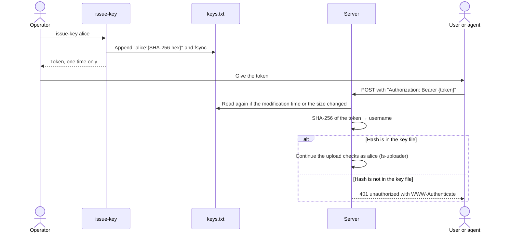

# ADR-006: Bearer token authentication with a hashed key file

Status: Accepted

Date: 2026-10-29

## Context

Only known users can upload. Retrieval is public.
Humans and AI agents use tokens in scripts and shell commands.
Tokens can leak into logs, shell history, and repositories.

## Decision

- The client sends the token in the header `Authorization: Bearer <token>`.
- Do not accept tokens in the URL. URLs go into access logs and browser history.
- Token format: `es.fs1.key.` followed by base64url of 32 random bytes (43 characters).
- The fixed prefix lets secret scanners find leaked tokens.
- The key file is `<FILESLOP_DATA_DIR>/keys.txt`.
- Each line has the format `username:<SHA-256 hex of token>`.
- Lines that start with `#` are comments. The server ignores comments and empty lines.
- One user can have several keys. This allows rotation.
- The server stores only SHA-256 hashes. It never stores a plaintext token.
- Tokens have 256 bits of entropy. Thus a fast hash is sufficient. A slow password hash is not necessary.
- The command `issue-key <username>` creates a token, appends the hash to the key file, and prints the token one time.
- `issue-key` flushes the new line to disk with `fsync`. If the last line has no newline, it adds a newline first.
- The running server reloads the key file when its modification time or its size changes.
- A missing or incorrect token gives status 401 with a `WWW-Authenticate` header with the `Bearer` scheme. The server sends `Bearer realm="fileslop"`.
- The server stores the authenticated username as object metadata `fs-uploader`.

## Consequences

Positive:

- A leak of the key file does not leak tokens.
- Secret scanners (GitHub push protection, our CI check) find leaked tokens.
- Key rotation and revocation need no server restart.
- Each upload has a known owner.

Negative:

- Nobody can recover a lost token. The operator must issue a new token.
- There are no scopes and no expiry dates in v0.1.
- The operator edits a text file to revoke a key.

## Alternatives considered

- Token in a query parameter: leaks into logs. Rejected.
- HTTP Basic authentication: no benefit over Bearer. Rejected.
- bcrypt or scrypt for hashes: not necessary for high-entropy tokens, and slow on each request. Rejected.
- OAuth or OpenID Connect: too complex for v0.1. Rejected.
