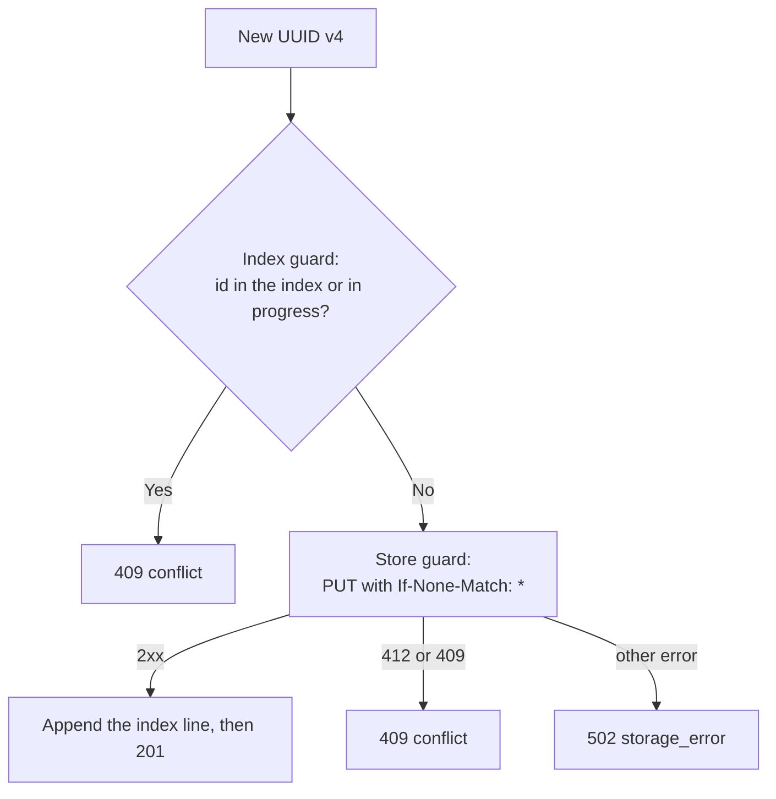

# ADR-008: The server never overwrites an object

Status: Accepted

Date: 2026-10-29

## Context

A public URL must always deliver the same content.
Other people link to the URL from pull requests and chats.
An overwrite would change the content behind a link without notice.
UUID v4 collisions are almost impossible. But a bug or a lost index can cause a collision.

## Decision

Use two guards:

1. Index guard: if the identifier is already in the index, the server returns status 409 with the error code `conflict`.
   The server also keeps the identifiers of uploads in progress in memory. A second upload with the same identifier gets 409.
2. Store guard: the S3 PUT request has the header `If-None-Match: *`. This is a conditional write. AWS S3 and the Ceph-based Hetzner Object Storage support it.

- If the store returns 412 or 409, the adapter returns `"exists"`.
- The server then returns status 409 with the error code `conflict`.
- The server never retries silently with a new identifier.

## Consequences

Positive:

- Stored objects are immutable. Long cache times are safe (see [ADR-010](ADR-010.md)).
- The store guard also protects against a lost or damaged index.
- An error is visible. A silent retry would hide a bug.

Negative:

- A store without conditional writes does not have the second guard.
- The mock S3 server in the tests must implement `If-None-Match: *`.
- The client sees a 409 in a very rare case. The client must retry the upload.
- Some APM agents change outgoing HTTP requests. The Dynatrace OneAgent removes the `If-None-Match` header.
  The server signs the header. Thus the store rejects the signature, and the server returns 502.
  On such hosts, disable the HTTP request injection of the agent for the server process.

## Alternatives considered

- Check with a HEAD request before the PUT: a race condition remains. Rejected.
- Retry with a new identifier: hides errors. Rejected.
- Object Lock or bucket versioning: depends on bucket configuration. Not necessary for v0.1.
