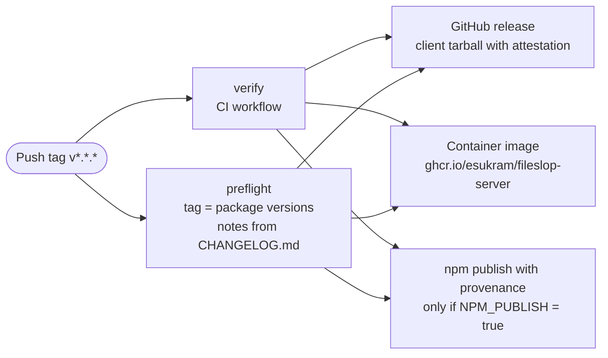

# ADR-016: GitHub repository protection and delivery

Status: Accepted

Date: 2026-10-29

## Context

The repository `esukram/fileslop` is public and uses the MIT license.
Releases publish an npm package and a container image.
A compromised workflow can publish malicious code to all users.

## Decision

Repository rulesets (not classic branch protection):

- Branch `main`: block deletion, block force push, require linear history, require a pull request, require status checks. The maintainer has an admin bypass.
- Tags `v*`: block deletion, block update.

Workflow security:

- Pin all actions to full commit SHAs.
- Set the default workflow token permissions to read-only.
- Set `persist-credentials: false` on each checkout.
- Use Dependabot for npm and GitHub Actions. Use a cooldown period.
- Enable CodeQL default setup.
- Enable secret scanning with push protection.
- Add a CI step that fails if the repository contains a token with the prefix `es.fs1.key.`.

CI on each push and pull request:

- Dependency audit (`pnpm audit --audit-level=high`).
- Lint, format check, and type check.
- Unit and end-to-end tests on Node.js 24 and Node.js 26.
- Build and pack of the client.
- Build of the server container image.

Release on each tag `v*`:

- Create a GitHub release. Take the notes from `CHANGELOG.md`.
- Attach the client tarball with a build provenance attestation.
- Push the server container image to `ghcr.io/esukram/fileslop-server`.
- Publish the client to npm with provenance through npm trusted publishing.
- Publish to npm only if the repository variable `NPM_PUBLISH` is `true`. Set it after the npm package setup.

Versions follow Semantic Versioning. The first version is 0.1.0 with the tag `v0.1.0`.

## Consequences

Positive:

- Contributors cannot change the history of `main` or move a release tag. Only the maintainer can, through the admin bypass.
- Pinned actions and read-only tokens reduce the risk of a workflow compromise.
- Users can verify the origin of the npm package and the tarball.
- Push protection and the CI check detect leaked tokens before or soon after a push.

Negative:

- Dependabot pull requests need review effort.
- The maintainer must set up npm trusted publishing manually one time.
- Linear history requires rebase or squash merges.
