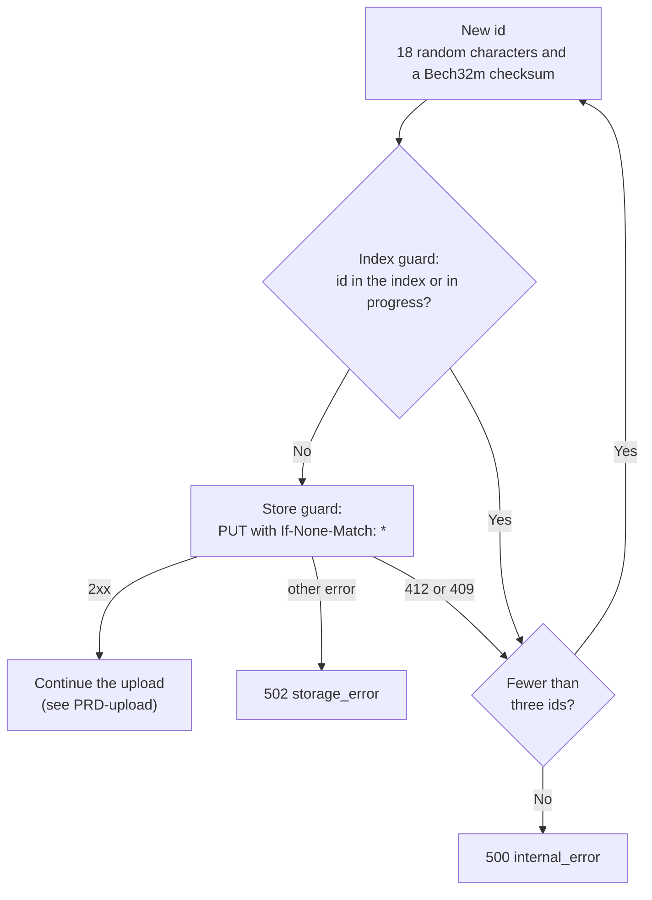

# ADR-019: Short Bech32m file identifiers and a new identifier after a collision

Status: Accepted

Date: 2026-10-29

## Context

The public URL contains the file identifier (see [ADR-004](ADR-004.md)).
A UUID v4 has 36 characters. Short URLs are easier to read, copy, and type.
The identifier is the only secret part of a public URL. Nobody must be able to guess it.
A 409 response after an identifier collision is not acceptable. The server must create a new identifier.
Bearer tokens start with `es.fs1.key.` (see [ADR-006](ADR-006.md)). File identifiers must not contain `fs1` as a prefix.
Links from versions 0.1.x contain UUIDs. These links must continue to work.

## Decision

Identifier format:

- The identifier has 24 characters from the Bech32 alphabet `qpzry9x8gf2tvdw0s3jn54khce6mua7l` (BIP-173).
- The first 18 characters are random. Each character comes from the low 5 bits of one byte from `crypto.randomBytes()`.
  Thus the identifier has 90 random bits.
- The last 6 characters are a Bech32m checksum (BIP-350).
- The checksum uses the human-readable part `fileslop`. The identifier does not contain the human-readable part or the separator `1`.
- A standard Bech32m decoder can verify an identifier if you put `fileslop1` before it.
- Identifiers are lowercase. The server rejects uppercase identifiers.
- Example: `https://files.example.org/fileslop/x6cnmzueszjvmgrevycrmwjd/plan.html`.

Collisions:

- The server creates a new identifier in these cases:
  - The identifier is in the index.
  - An upload in progress uses the identifier.
  - The store returns 412 or 409 to the conditional write (see [ADR-008](ADR-008.md)).
- The server tries a maximum of three identifiers. Then it returns 500 `internal_error`.
  Three collisions in sequence show a defective identifier generator. The client cannot correct this.
- The server writes a warning for each collision. The warning does not contain the identifier, because the identifier is a secret.
- The server does not try a new identifier after a store failure or an index failure. In these cases, the object or the index record can exist.
- The server checks the index and the uploads in progress, and then reserves the identifier, without an `await` between these steps.

Retrieval:

- A GET request accepts a UUID from versions 0.1.x or an identifier with a correct checksum. For other values, the server returns 404.

This ADR replaces these parts of earlier ADRs:

- [ADR-004](ADR-004.md): the UUID v4 identifier. The object key layout stays.
- [ADR-008](ADR-008.md): the 409 response after a collision and the rule "never retry with a new identifier".
  The two guards and the rule "never overwrite an object" stay.

## Consequences

Positive:

- The identifier is 12 characters shorter than a UUID.
- The checksum finds most typing errors. The server returns 404 for an identifier with an incorrect checksum, without an index lookup.
- A client does not see a collision.
- Links from versions 0.1.x continue to work.

Negative:

- The identifier has 90 random bits. A UUID v4 has 122. The checksum adds no secret bits.
  The probability that a guesser finds one file is approximately `N × Q / 2^90` (N: number of files, Q: number of guesses).
  - 10^6 files, 10^4 guesses each second for one year: approximately 2.5 × 10^-10.
  - 10^9 files, 10^6 guesses each second for one year: approximately 2.5 × 10^-5.
  - These values assume that the guesser knows the filename. The server has no rate limit. Operators can find guess attacks in the 404 rate of the request log.
- The identifier alone is not a standard Bech32m string. A standard decoder needs the prefix `fileslop1`.
- The store guard protects the key `<week>/<id>/<filename>`, not the identifier.
  If the index is lost, a new upload can get the identifier of an older file in a different week or with a different filename.
  If the filename is the same, the old URL then delivers the new file. With 90 random bits, this is very improbable.
  This limit also applied to UUIDs. The server must run as one process (see [ADR-005](ADR-005.md)).

## Alternatives considered

- XOR the current time in milliseconds into the random bits: XOR with a known value does not change the collision probability. The time cannot be read from the identifier. Rejected.
- Time prefix, as in ULID: shows the upload time in the URL and gives fewer random bits for the same length. Rejected.
- Visible human-readable part, for example `f1…`: a standard Bech32m string, but 2 more characters and a visible prefix. Rejected.
- 80 random bits (22 characters): less margin against guessing. 100 random bits (26 characters): longer URL. Rejected.
- Original Bech32 checksum (BIP-173): it does not find some insertions and deletions of `q` before a final `p`. Rejected.
- A 409 response after a collision, as in [ADR-008](ADR-008.md): the client must retry. Rejected.
