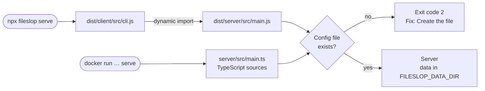

# ADR-020: The fileslop package runs the server, and the server needs a config file

Status: Accepted

Date: 2026-11-07

## Context

Operators run the server from the container image only (see [ADR-016](ADR-016.md)).
Some operators prefer one command without a container, like `npx t3` for T3 Code.
The npm package `fileslop` contains only the client (see [ADR-013](ADR-013.md)).
Node.js does not strip TypeScript types in `node_modules` (see [ADR-001](ADR-001.md)).
The server read `.env` and `./data` from the current folder (see [ADR-012](ADR-012.md)).
With `npx`, the current folder changes from one start to the next.
A start from a different folder gives an empty `index.jsonl`. Then all old URLs return 404.
Without configuration, the server cannot store or deliver files.

## Decision

Package:

- The npm package `fileslop` contains the client and the server. There is no second package.
- `tsc` compiles `client/src` and `server/src` to `client/dist/client/src` and `client/dist/server/src`.
- The `bin` entry is `dist/client/src/cli.js`.
- The client reads its version with `module.findPackageJSON()`. Thus the same code works in the sources and in `dist/`.
- The container image continues to run the TypeScript sources without a build step.

Commands:

- `fileslop serve [--config <file>]` starts the server.
- `fileslop issue-key <username> [--config <file>]` creates a token.
- The client loads the server code only for these two commands. `upload` and `config` do not load it.
- `server/src/main.ts` exports `main(argv)` and `USAGE`. It starts itself only if Node.js runs it directly.
- `fileslop help serve` shows the server help.
- Errors of the server commands have a `Fix:` line, like the client errors.

Configuration:

- The server config file is `$XDG_CONFIG_HOME/fileslop/.env`. The default is `~/.config/fileslop/.env`.
- `--config <file>` gives a different path.
- `serve` and `issue-key` stop with exit code 2 if the config file does not exist. The message names the path.
- `issue-key` also needs the file, because the file can set `FILESLOP_DATA_DIR`. Thus both commands use the same data folder.
- Real environment variables have priority over the file.
- The server does not read `.env` from the current folder.
- The default of `FILESLOP_DATA_DIR` is the config folder `~/.config/fileslop`.
- The server creates a new data folder with mode `0700`. It creates `index.jsonl` with mode `0600`.
- The container image sets `XDG_CONFIG_HOME=/config`. Thus the file in the container is `/config/fileslop/.env`.

## Consequences

Positive:

- `npx fileslop serve` starts a server without a container and without a clone of the repository.
- One package, one version, and one npm trusted publisher.
- The data folder does not depend on the current folder. A start from a different folder finds the same data.
- A missing configuration stops the server at start with a clear message.

Negative:

- Container users must mount the config file. `docker run --env-file` alone does not start the server.
- Starts from the sources need `--config` or the default config file. The old `.env` in the `server` folder is not read.
- Each client download also contains the server code. The package grows to approximately 17 KB.
- The `dist/` folder has a nested layout: `dist/client/src` and `dist/server/src`.
- `module.findPackageJSON()` has the stability index 1.1 (active development) in Node.js 24 and 26.

## Alternatives considered

- A second package `fileslop-server`: a second trusted publisher, and the command is not `npx fileslop serve`. Rejected.
- A bundler, for example tsdown like T3 Code: a new development dependency. `tsc` is sufficient without runtime dependencies. Rejected.
- The data folder `$XDG_STATE_HOME/fileslop`: correct for XDG, but the data is then in a second folder. One folder is easier to back up. Rejected.
- Environment variables without a file, as before: the operator must give the variables again for each start. The error does not tell where the configuration belongs. Rejected.
