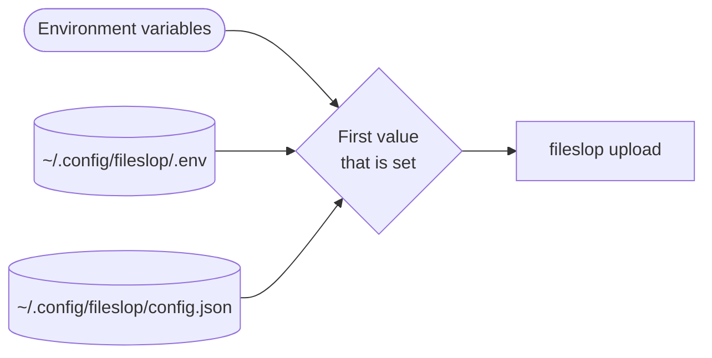

# ADR-021: Global installation of the client first, and a .env file for the client

Status: Accepted

Date: 2026-11-07

## Context

Users run the client with `npx -y fileslop` (see [ADR-013](ADR-013.md)).
Before the first upload, each user must set a server URL and a token one time. Thus a one-time setup step exists already.
Without `-y`, `npx` asks for permission to install the package. An agent in a pseudo-terminal cannot answer this question.
`npx -y fileslop` can use a new published version without a check by the user.
Agents in CI and in sandboxes have no global installation. They get the URL and the token as environment variables.
The server reads the config file `~/.config/fileslop/.env` (see [ADR-020](ADR-020.md)). The client reads `config.json` in the same folder.

## Decision

Installation:

- The documentation tells users to install the client one time: `npm install -g fileslop`.
- The commands in the documentation and in the agent skill are `fileslop …`.
- Without a global installation, use `npx -y fileslop` in place of `fileslop`. The skill tells agents to do this if the shell does not find `fileslop`.
- The documentation tells users to update with `npm update -g fileslop`.

Configuration:

- The client also reads `FILESLOP_URL` and `FILESLOP_TOKEN` from the file `.env` in the folder of `config.json`. The default is `~/.config/fileslop/.env`.
- `FILESLOP_CONFIG` continues to give the path of `config.json`. The `.env` file is in the same folder. There is no separate variable for the `.env` path.
- The priority is: environment variables, then `.env`, then `config.json`.
- The client parses the file with `util.parseEnv()`. It does not change `process.env`.
- `fileslop config` shows the path of the `.env` file in the field `envFile`.
- Configuration errors tell the user to set the values in the `.env` file or in the environment.
- On a host with the server and the client, one `.env` file can hold the values for both. The variable names are different.

## Consequences

Positive:

- Humans type `fileslop upload plan.html`. There is no install question and no `-y`.
- Agents on a workstation use the installed client. They do not wait for the npm registry.
- The installed version changes only after an update by the user. This reduces the supply-chain risk.
- Server and client use the same file format and the same folder.
- `config.json` continues to work. The change is not breaking.

Negative:

- A global installation can be old. Users must update it.
- The skill has two commands: `fileslop` and the fallback `npx -y fileslop`.
- A global installation with npm can need a different npm prefix on some systems.

## Alternatives considered

- `npx -y fileslop` only: each call can contact the npm registry and can get a new version. Rejected as the main way. It stays the fallback.
- `npx fileslop` without `-y`: agents in a pseudo-terminal can wait for the install question. Rejected for agents.
- `.env` only, without `config.json`: breaks existing setups. Rejected.
