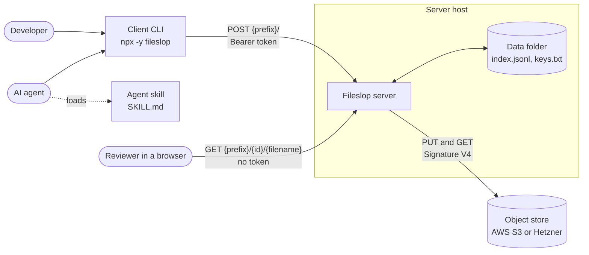

# Fileslop architecture

Fileslop is a small HTTP service. It stores uploaded files in an object store and returns a stable public URL.
The system has four components:

- **Server** (`server/`): accepts authenticated uploads and delivers files to the public.
- **Client CLI** (`client/`, npm package `fileslop`): uploads files from a shell. Humans and AI agents use it.
- **Agent skill** (`skills/fileslop/`): tells AI agents how to upload files and attach them to pull requests.
- **Object store**: AWS S3 or Hetzner Object Storage. It keeps the file content and metadata.

The server keeps a lookup index and a key file in a local data folder.
For product requirements, see [PRDs](../prds/prds.md).

## Architecture decision records

| ADR                   | Title                     | Decision                                                                                   |
| --------------------- | ------------------------- | ------------------------------------------------------------------------------------------ |
| [ADR-001](ADR-001.md) | Runtime                   | Use Node.js 24.2 or later with native type stripping and no runtime dependencies.          |
| [ADR-002](ADR-002.md) | Repository layout         | Use one pnpm workspace with `server/`, `client/`, `skills/fileslop/`, `e2e/`, and `docs/`. |
| [ADR-003](ADR-003.md) | Object store adapter      | Use one S3-protocol adapter with our own Signature V4 code for AWS S3 and Hetzner.         |
| [ADR-004](ADR-004.md) | Identifier and key layout | Use UUID v4 identifiers and object keys with ISO week folders.                             |
| [ADR-005](ADR-005.md) | Lookup index              | Keep the index in memory and persist it in an append-only JSON Lines file.                 |
| [ADR-006](ADR-006.md) | Authentication            | Use Bearer tokens with a fixed prefix and store only their SHA-256 hashes.                 |
| [ADR-007](ADR-007.md) | Content type              | Require the client to send the content type. The server never sniffs.                      |
| [ADR-008](ADR-008.md) | No overwrite              | Reject an existing identifier and use conditional S3 writes.                               |
| [ADR-009](ADR-009.md) | Header validation         | Validate filename and metadata headers strictly and reject invalid values.                 |
| [ADR-010](ADR-010.md) | Safe delivery             | Deliver files with `nosniff`, a sandbox policy, and immutable cache headers.               |
| [ADR-011](ADR-011.md) | Upload size               | Buffer the body in memory up to 25 MiB by default.                                         |
| [ADR-012](ADR-012.md) | Configuration             | Use `FILESLOP_` environment variables, a `.env` file, and a client JSON file.              |
| [ADR-013](ADR-013.md) | Client CLI design         | Publish a compiled `fileslop` package with agent-friendly output and exit codes.           |
| [ADR-014](ADR-014.md) | Testing                   | Use `node:test` with unit tests and end-to-end tests against a mock S3 server.             |
| [ADR-015](ADR-015.md) | Tooling                   | Use TypeScript 6.0, ESLint 10, Prettier 3, and pnpm with a release age delay.              |
| [ADR-016](ADR-016.md) | GitHub and delivery       | Use rulesets, pinned actions, CI checks, and releases with provenance to npm and GHCR.     |
| [ADR-017](ADR-017.md) | Agent skill               | Supply a short `SKILL.md` for uploads and pull request artifacts.                          |
| [ADR-018](ADR-018.md) | Documentation language    | Write all text in ASD-STE100 Simplified Technical English.                                 |
