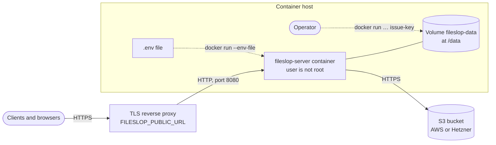

# PRD: Deployment

## Problem

Operators must run the Fileslop server with little effort.
The server needs object store credentials, a public URL, and persistent local data.
Errors in the configuration must be visible at start, not at the first upload.

## Users

- Operators who run Fileslop on a host or in a container platform.

## Goals

- Run the server from a container image or from source.
- Configure the server with environment variables only.
- Keep the index and the key file across restarts and upgrades.

## Non-goals

- Several server instances behind a load balancer.
- TLS termination in the server. Use a reverse proxy.
- A Helm chart or other platform-specific packages.

## Functional requirements

- FR-1: The server MUST read its configuration from `FILESLOP_` environment variables (see [ADR-012](../architecture/ADR-012.md)).
- FR-2: The server MUST read an optional `.env` file with `process.loadEnvFile()`.
- FR-3: Real environment variables MUST have priority over the `.env` file.
- FR-4: The repository MUST contain `server/.env.sample` with all variables and a comment for each variable.
- FR-5: The server MUST stop at start with exit code 2 if a variable is missing or invalid. The message MUST list all problems.
- FR-6: The server MUST listen on `FILESLOP_HOST` (default `0.0.0.0`) and `FILESLOP_PORT` (default `8080`).
- FR-7: The path of `FILESLOP_PUBLIC_URL` MUST be the route prefix for all endpoints.
- FR-8: The server MUST create `FILESLOP_DATA_DIR` if it does not exist.
- FR-9: Each release MUST publish a container image to `ghcr.io/esukram/fileslop-server`.
- FR-10: The container image MUST declare `FILESLOP_DATA_DIR` as a volume.
- FR-11: The container MUST run as a user that is not root.
- FR-12: The container MUST support `issue-key <username>` as a command.
- FR-13: The server MUST give `/healthz` under the route prefix for health checks.

## Deployment procedure



1. Create a bucket in AWS S3 or Hetzner Object Storage.
2. Create an access key with read and write access to the bucket only.
3. Copy `server/.env.sample` to `.env` on the host.
4. Set the values in `.env`. Do not set `FILESLOP_DATA_DIR`. The image sets `FILESLOP_DATA_DIR=/data`, and a value in `.env` overrides it.
5. Start the container. The image does not contain a `.env` file. Give the file to Docker with `--env-file`:

   ```sh
   docker run --env-file .env -v fileslop-data:/data -p 8080:8080 ghcr.io/esukram/fileslop-server:0.2.0
   ```

6. Create a token for each user. Use the same volume:

   ```sh
   docker run --rm -v fileslop-data:/data ghcr.io/esukram/fileslop-server:0.2.0 issue-key <username>
   ```

7. Give the token to the user. The command shows the token one time only.
8. Configure the reverse proxy to send requests for the route prefix to the server.

## Non-functional requirements

- NFR-1: Run exactly one server instance for each data folder.
- NFR-2: The data folder MUST be on persistent storage. A loss of `index.jsonl` makes old URLs unavailable.
- NFR-3: The container image MUST contain no runtime dependencies other than Node.js.

## Acceptance criteria

- AC-1: The server starts from environment variables and accepts uploads. (e2e: `e2e/server.test.ts`)
- AC-2: The server stops with exit code 2 if variables are missing or invalid. The message lists all problems, also a missing `FILESLOP_PUBLIC_URL` and a `FILESLOP_S3_ENDPOINT` that is not http(s). (e2e: `e2e/server.test.ts`)
- AC-3: The server starts from a `.env` file with the `aws_s3` backend. A real environment variable (`FILESLOP_BASE_DIR`) overrides the `.env` value. (e2e: `e2e/server.test.ts`)
- AC-4: With `FILESLOP_PUBLIC_URL=https://files.example.org/fileslop/`, `GET /fileslop/healthz` returns 200. (e2e: `e2e/server.test.ts`)
- AC-5: After a restart with the same data folder, old URLs still work. (e2e: `e2e/server.test.ts`)
- AC-6: CI builds the container image and runs its `help` command. (CI step in `.github/workflows/ci.yml`)
- AC-7: The release workflow pushes a container image for tag `v0.1.0`. (not automated: manual check of the first release)
