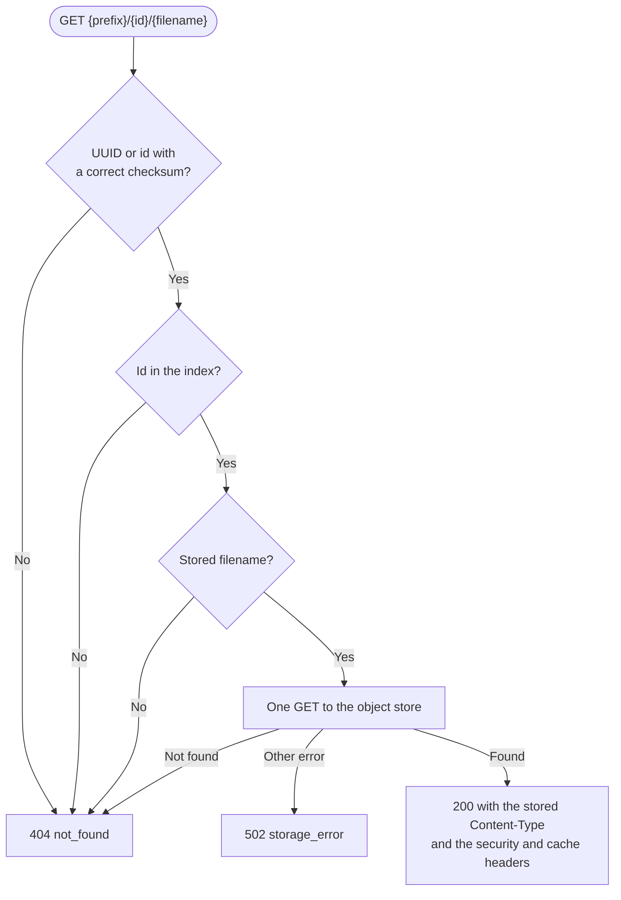

# PRD: Retrieval

## Problem

People open shared links in a browser, in a pull request, or in a chat.
They must see the file without a login.
The file must not harm the reader or the Fileslop origin.

## Users

- Reviewers who open artifact links in pull requests.
- AI agents that download artifacts.
- Operators who check the server health.

## Goals

- Deliver each file at a stable public URL.
- Deliver the file with the content type that the uploader declared.
- Keep interactive HTML artifacts working and isolated.

## Non-goals

- Directory listings.
- Search.
- Access control for retrieval.
- Range requests and partial content.

## Functional requirements

- FR-1: The server MUST deliver files with `GET <prefix>/<id>/<filename>` without authentication.
  `<id>` is a UUID from v0.1.0 or a Bech32m identifier with a correct checksum (see [ADR-019](../architecture/ADR-019.md)).
  For other values, the server MUST return 404 `not_found`.
- FR-2: The server MUST read the object key from the index. It MUST NOT list the bucket.
- FR-3: The server MUST return status 200 and the stored bytes for a known identifier and the correct filename.
- FR-4: The response MUST have the stored `Content-Type`.
- FR-5: The response MUST have `X-Content-Type-Options: nosniff`.
- FR-6: The response MUST have `Content-Security-Policy: sandbox allow-scripts`.
- FR-7: The response MUST have `Cache-Control: public, max-age=31536000, immutable`.
- FR-8: The server MUST return status 404 with `{"error": "not_found", "message": "<text>"}` in these cases:
  - The identifier is not in the index.
  - The filename is not the stored filename.
  - The object is not in the store.

- FR-9: The server MUST return status 200 with `{"status":"ok"}` for `GET <prefix>/healthz`.
- FR-10: The health check MUST NOT need authentication.
- FR-11: The server MUST return status 502 `storage_error` if the store fails with an error other than "not found".
- FR-12: The server MUST answer `HEAD` requests for files and for the health check with the headers of `GET` and without a body.

## Non-functional requirements

- NFR-1: A GET MUST need only one request to the object store.
- NFR-2: The health check MUST NOT send requests to the object store.
- NFR-3: The server MUST NOT show internal object keys or bucket names in error messages.

## Acceptance criteria

- AC-1: A GET of an uploaded file returns 200 and the same bytes. (e2e: `e2e/server.test.ts`)
- AC-2: The GET response has the stored content type and the three security and cache headers. (e2e: `e2e/server.test.ts`)
- AC-3: A GET with an unknown identifier returns 404 `not_found`. (e2e: `e2e/server.test.ts`)
- AC-4: A GET with a known identifier and a wrong filename returns 404. (e2e: `e2e/server.test.ts`)
- AC-5: A GET for an object that the test removed from the mock store returns 404. (e2e: `e2e/server.test.ts`)
- AC-6: `GET <prefix>/healthz` returns 200 `{"status":"ok"}`. (e2e: `e2e/server.test.ts`)
- AC-7: A HEAD of an uploaded file returns 200, the stored content type, and no body. (e2e: `e2e/server.test.ts`)
- AC-8: A GET that fails in the object store returns 502 `storage_error`. (not automated)
