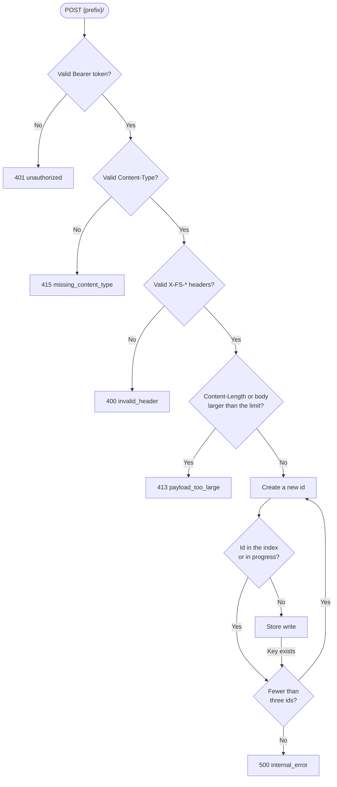
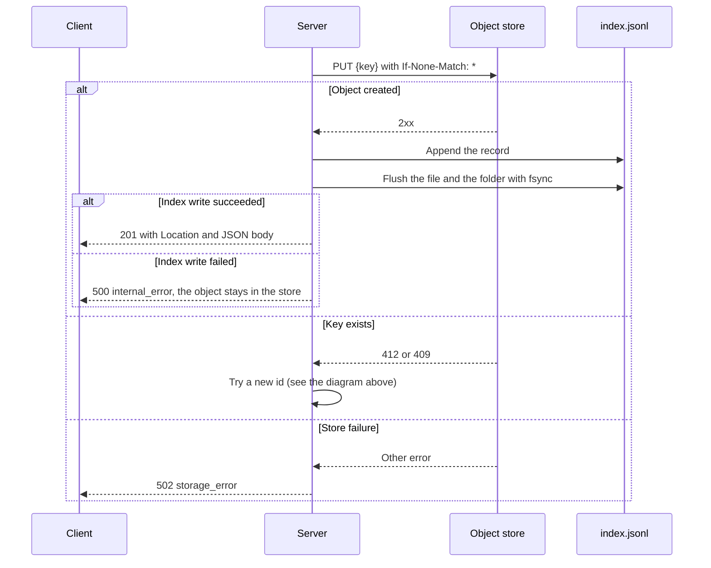

# PRD: Upload

## Problem

Humans and AI agents create artifacts such as HTML plans, screenshots, logs, and reports.
They need a fast way to put an artifact on the web and get a link.
GitHub pull requests cannot attach arbitrary files.

## Users

- Developers who share artifacts with a team.
- AI coding agents that create artifacts during their work.

## Goals

- Upload one file with one authenticated HTTP request.
- Get a stable public URL in the response.
- Get clear, machine-readable errors.

## Non-goals

- Upload of several files in one request.
- Change or deletion of an uploaded file.
- Uploads larger than the configured limit.
- Anonymous uploads.

## Functional requirements

- FR-1: The server MUST accept uploads with `POST <prefix>/`. `<prefix>` is the path of `FILESLOP_PUBLIC_URL`.
- FR-2: The server MUST require a valid Bearer token (see [PRD-authentication](PRD-authentication.md)).
- FR-3: The server MUST require the header `X-FS-Filename` with the pattern `^[A-Za-z0-9][A-Za-z0-9._-]{0,254}$`.
- FR-4: The server MUST accept the optional headers `X-FS-Username`, `X-FS-Repository`, and `X-FS-Repository-Provider` with the pattern `^[A-Za-z0-9][A-Za-z0-9._/-]{0,127}$`.
- FR-5: The server MUST reject an invalid header value. It MUST NOT rewrite the value.
- FR-6: The server MUST require a syntactically valid `Content-Type` header. It MUST NOT infer or sniff the type.
- FR-7: The server MUST accept an empty body and store a file with 0 bytes.
- FR-8: The server MUST reject a body larger than `FILESLOP_MAX_UPLOAD_BYTES`.
- FR-9: The server MUST create a new identifier for each upload as described in [ADR-019](../architecture/ADR-019.md): 18 random Bech32 characters and a 6-character Bech32m checksum.
- FR-10: The server MUST store the file as described in [PRD-storage-backends](PRD-storage-backends.md).
- FR-11: On success, the server MUST return status 201, a `Location` header with the public URL, and this JSON body:

```json
{
  "id": "x6cnmzueszjvmgrevycrmwjd",
  "url": "https://files.example.org/fileslop/x6cnmzueszjvmgrevycrmwjd/plan.html",
  "filename": "plan.html",
  "contentType": "text/html",
  "size": 1234
}
```

- FR-12: On failure, the server MUST return a JSON body `{"error": "<code>", "message": "<text>"}` with one of these codes:

| Code                   | Status | Cause                                        |
| ---------------------- | ------ | -------------------------------------------- |
| `unauthorized`         | 401    | The token is missing or incorrect.           |
| `invalid_header`       | 400    | A header is missing or has an invalid value. |
| `missing_content_type` | 415    | The content type is missing or invalid.      |
| `payload_too_large`    | 413    | The body is larger than the limit.           |
| `storage_error`        | 502    | The object store failed.                     |
| `internal_error`       | 500    | Another server error occurred.               |

This diagram shows the current order of the checks. The first failed check stops the upload.
The order between invalid input headers is not a contract. Authentication is always the first check.



The store write:



- FR-13: The server MUST NOT write an index line if the store write fails.
- FR-14: The server MUST try a maximum of three identifiers, and then return 500 `internal_error`. The server MUST NOT create a new identifier after a store or index failure.
  The server MUST create a new identifier in these cases:
  - The identifier is in the index.
  - An upload in progress uses the identifier.
  - The store reports an existing key.
- FR-15: The server MUST return 500 `internal_error` for other errors. Example: the index write fails after the store write.
  In this case, the object is in the store, but the in-memory index has no entry for it. The URL does not work.
  The index file can contain the record if the write completed before the error. Then the URL works after a restart.

## Non-functional requirements

- NFR-1: The server MUST NOT keep more than the upload limit of body data for one request.
  The server rejects the request when a received chunk makes the total larger than the limit.
  The server keeps the received chunks and then joins them into one buffer.
  Thus the peak memory for one request body is approximately two times the upload limit.
- NFR-2: If the `Content-Length` header is larger than the limit, the server MUST return 413 before it reads the body.
- NFR-3: The server MUST NOT write tokens or object store credentials to logs.

## Acceptance criteria

- AC-1: A valid upload returns 201, the JSON body, and a `Location` header. (e2e: `e2e/server.test.ts`)
- AC-2: A GET of the returned URL delivers the same bytes. (e2e: `e2e/server.test.ts`)
- AC-3: An upload without a token returns 401. (e2e: `e2e/server.test.ts`)
- AC-4: An upload with the filename `../etc/passwd` returns 400. An invalid metadata header returns 400 `invalid_header`. (e2e: `e2e/server.test.ts`)
- AC-5: An upload without `Content-Type` returns 415 `missing_content_type`. (e2e: `e2e/server.test.ts`)
- AC-6: An upload with an empty body returns 201, and GET returns 0 bytes. (e2e: `e2e/server.test.ts`)
- AC-7: An upload larger than the limit returns 413 `payload_too_large`. A chunked upload without `Content-Length` that is larger than the limit also returns 413. (e2e with a small limit: `e2e/server.test.ts`)
- AC-8: A store failure returns 502 `storage_error`. (e2e with a failing mock: `e2e/server.test.ts`)
- AC-9: Two concurrent uploads that get the same identifier both return 201 with different identifiers. (unit: `server/test/app.test.ts`)
- AC-10: A failed index write after a successful store write returns 500 `internal_error`. The server does not try a new identifier. (unit: `server/test/app.test.ts`)
